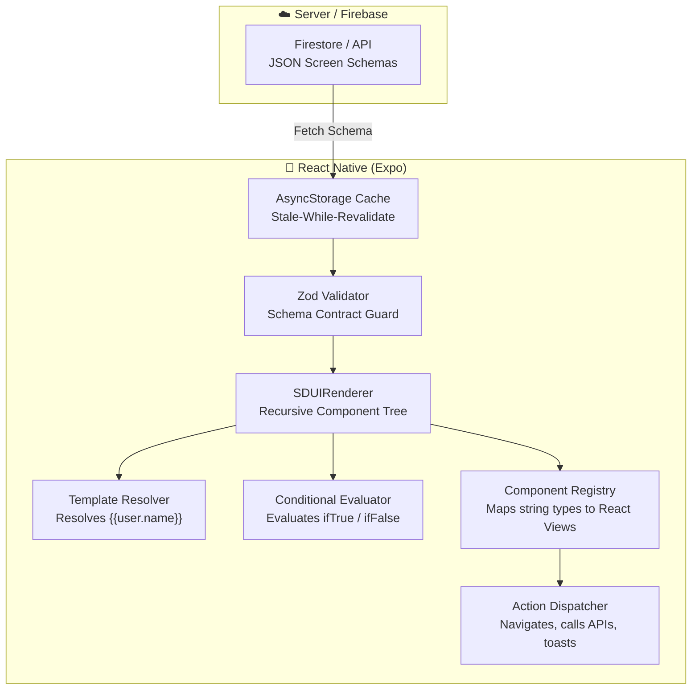

# 🚀 SDUI-React — Production Server-Driven UI Engine

> A high-performance, production-grade **Server-Driven UI (SDUI)** engine built with **React Native (Expo)**, **TypeScript**, **Zustand**, and **Firebase Firestore**.

Render and reconfigure entire screens and mobile user journeys dynamically from JSON schemas — without waiting for App Store or Google Play releases.

---

## ✨ Features

- ⚡ **Zero-Code Screen Delivery**: Ship new layouts, campaigns, and feature sections instantly by updating JSON on your server or Firestore.
- 🧩 **Recursive UI Tree Engine**: The backend owns the screen. `root` is the layout, `overlay` is anything pinned on top, and every label, color, and action is a field in the JSON.
- 🎯 **Template Interpolation**: Seamlessly inject dynamic user and app state into text, image URLs, and properties using `{{user.name}}`, `{{item.price}}`, etc.
- 🔀 **Conditional Rendering**: Show, hide, or swap UI branches dynamically (e.g. show `PremiumBanner` for VIPs, or `UpgradeCTA` for free-tier users) via `condition` blocks.
- 🚀 **Remote, Local & State Data Sources**: Lists can point to REST APIs (`type: "remote"`), a Zustand value (`type: "state"` with `stateKey` and optional `filters`), or static arrays (`type: "local"`), rendering items via reusable `itemTemplate`s.
- 🎯 **Action Dispatcher**: Navigation, alerts, bottom sheets, URLs, and state mutations dispatched from schema event handlers (`onPress`, `onAction`).
- 🛡️ **Fail-Safe & Type-Safe**: Runtime schema validation via **Zod** + per-component **Error Boundaries** to ensure a malformed widget never crashes your app.
- 💾 **Cache Policies**: `metadata.cachePolicy` is `no-cache`, `cache-first`, or `stale-while-revalidate`. `cacheTTL` is seconds. Stale-while-revalidate paints the AsyncStorage copy immediately and refreshes from Firestore in the background once the TTL has passed.
- 🛠️ **Live In-App Schema Playground**: Test and hot-swap JSON schemas in real-time inside the app with immediate visual feedback.

---

## 🏗️ Architecture



---

## 📐 JSON Schema Contract Example

```json
{
  "screenId": "home",
  "version": 2,
  "metadata": {
    "title": "Home",
    "cachePolicy": "stale-while-revalidate",
    "cacheTTL": 300
  },
  "root": {
    "type": "ScrollView",
    "props": { "showsIndicators": false },
    "children": [
      {
        "type": "HeroBanner",
        "props": {
          "title": "Welcome back, {{user.name}}",
          "subtitle": "Discover curated gear tailored to you",
          "badgeText": "HOT DROP",
          "ctaText": "Explore Catalog",
          "backgroundImage": "https://images.unsplash.com/photo-1618005182384-a83a8bd57fbe"
        },
        "actions": {
          "onPress": {
            "type": "navigate",
            "payload": { "screen": "explore" }
          }
        }
      },
      {
        "type": "ConditionalRender",
        "condition": {
          "expression": "{{user.isPremium}}"
        },
        "ifTrue": {
          "type": "PremiumBanner",
          "props": {
            "title": "VIP Lounge Active",
            "message": "0% transaction fees enabled"
          }
        },
        "ifFalse": {
          "type": "UpgradeCTA",
          "props": {
            "title": "Upgrade to Pro",
            "message": "Get exclusive drops and perks"
          }
        }
      },
      {
        "type": "HorizontalList",
        "props": { "itemSpacing": 14 },
        "dataSource": {
          "type": "local",
          "data": [
            { "id": "1", "title": "Neural Audio Pro", "price": "$299", "image": "..." }
          ]
        },
        "itemTemplate": {
          "type": "ProductCard",
          "props": {
            "id": "{{item.id}}",
            "title": "{{item.title}}",
            "price": "{{item.price}}"
          }
        }
      }
    ]
  }
}
```

---

## 📂 Project Directory Structure

```text
sdui-React/
├── src/
│   ├── sdui/                      # 🧠 Core SDUI Engine
│   │   ├── types.ts               # JSON schema contracts & types
│   │   ├── SDUIRenderer.tsx       # Recursive rendering engine & error boundary
│   │   ├── ComponentRegistry.ts   # Maps type strings -> React Native components
│   │   ├── TemplateResolver.ts    # Interpolates {{variables}} from context
│   │   ├── ActionDispatcher.ts    # Executes navigation, toasts, URLs, & APIs
│   │   ├── ConditionalEvaluator.ts# Condition evaluator (ifTrue / ifFalse)
│   │   └── SchemaValidator.ts     # Zod schema validation
│   │
│   ├── components/
│   │   ├── primitives/            # Low-level layout blocks
│   │   │   ├── SDUIView.tsx
│   │   │   ├── SDUIText.tsx
│   │   │   ├── SDUIImage.tsx
│   │   │   ├── SDUIScrollView.tsx
│   │   │   ├── SDUITouchable.tsx
│   │   │   └── SDUISpacer.tsx
│   │   │
│   │   ├── composites/            # Generic widgets. Copy and color come from the schema
│   │   │   ├── Header.tsx
│   │   │   ├── Card.tsx
│   │   │   ├── IconRow.tsx
│   │   │   ├── HeroBanner.tsx
│   │   │   ├── SectionHeader.tsx
│   │   │   ├── ProductCard.tsx
│   │   │   ├── HorizontalList.tsx
│   │   │   ├── VerticalList.tsx
│   │   │   ├── ChipGroup.tsx
│   │   │   ├── MetricCard.tsx
│   │   │   ├── UpgradeCTA.tsx
│   │   │   ├── PremiumBanner.tsx
│   │   │   └── Button.tsx
│   │   │
│   │   └── conditional/
│   │       └── ConditionalRender.tsx
│   │
│   ├── schemas/                   # Bundled seed schemas
│   │   ├── home.json
│   │   └── explore.json
│   │
│   ├── services/
│   │   ├── firebase.ts            # Firebase Firestore client
│   │   └── schemaService.ts       # Network + AsyncStorage cache layer
│   │
│   ├── store/
│   │   ├── useAppStore.ts         # Global app state & live schema editor store
│   │   └── useUserStore.ts        # User profile & interactive VIP toggle
│   │
│   └── theme/
│       └── tokens.ts              # Design tokens (colors, spacing, typography)
```

---

## 🚀 Getting Started

### 1. Install Dependencies
```bash
npm install
```

### 2. Start the Development Server
```bash
# Start Expo interactive bundler
npm run start

# Run on Web directly
npm run web

# Run on Android
npm run android

# Run on iOS (requires macOS)
npm run ios
```

---

## 🛠️ Testing the Live SDUI Playground

1. Open the app on Web, iOS, or Android.
2. Tap the **`{ }`** button in the top right of the header.
3. Paste any screen JSON or load a preset (**Catalog** or **FinTech / Crypto**). The same renderer paints whatever the schema describes.
4. Tap **Apply Schema Live 🚀** — the screen instantly reconfigures without app restart!
5. Tap the **👑 VIP / ⚡ FREE** toggle in the top bar to watch the `ConditionalRender` component immediately switch between `UpgradeCTA` and `PremiumBanner`.

---

## ☁️ Connecting Firebase Firestore

To fetch schemas from a live Firebase project:

1. Create a Firebase project at [console.firebase.google.com](https://console.firebase.google.com).
2. Create a Firestore database.
3. Add a collection named `sdui_screens`.
4. Create a document with ID `home` and paste the contents of `src/schemas/home.json` as fields.
5. Create a `.env` file in the root with:
   ```env
   EXPO_PUBLIC_FIREBASE_API_KEY=your_api_key
   EXPO_PUBLIC_FIREBASE_AUTH_DOMAIN=your_project.firebaseapp.com
   EXPO_PUBLIC_FIREBASE_PROJECT_ID=your_project_id
   EXPO_PUBLIC_FIREBASE_STORAGE_BUCKET=your_project.appspot.com
   EXPO_PUBLIC_FIREBASE_MESSAGING_SENDER_ID=your_sender_id
   EXPO_PUBLIC_FIREBASE_APP_ID=your_app_id
   ```

---

## 📄 License
MIT © [Shubhanshu Shrimali](https://github.com/shubhanshushrimali)
